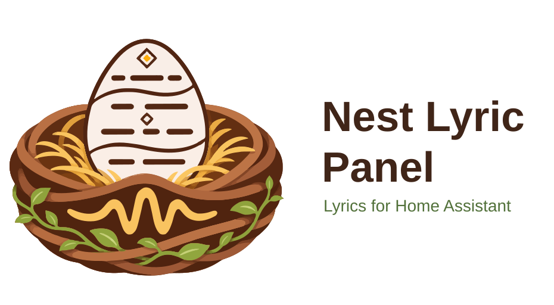

<picture>
  <source media="(prefers-color-scheme: dark)" srcset="assets/logo-dark.svg">
  
</picture>

# Nest Lyric Panel

A Home Assistant integration and dashboard panel for Nest Hub, TVs and other screens. It combines album artwork and playback controls with time-synced or plain song lyrics. The panel uses a media player's metadata, looks up lyrics in LRCLIB, and can optionally ask a self-hosted English-to-Ukrainian translation endpoint for translations.

> Early preview: the project has not yet been validated on every Home Assistant installation or hardware. It does not include song lyrics or model weights.

## Features

- LRCLIB lookup by artist, track, album and duration; exact metadata is important.
- Timestamped lyrics follow the playback position. Plain lyrics can be scrolled manually.
- Configurable timing offset and maximum difference between lyrics and track durations.
- A reusable lyrics card and a complete Nest Hub / TV display with artwork, playback controls, read-only track progress, track and artist.
- Optional English-to-Ukrainian translation via a separate compatible endpoint. Without it, original lyrics still work.
- English and Ukrainian interface text. Five numeric modes are shared by the card and the backend.

The card needs a media player that exposes `media_title` and `media_artist`. Synchronization also requires a track duration, playback position, position update timestamp and matching timed lyrics.

## Installation

Requires Home Assistant 2026.11 or later. The Marketplace is available in Home Assistant 2026.11. This repository is intended to be added as a **custom integration repository**; it is not automatically part of the public catalog.

1. In **Settings → Marketplace**, add `https://github.com/v-skochko/nest-lyric-panel` as a custom repository of type **Integration**, then install it. A GitHub connection may be needed for custom repositories.
2. Restart Home Assistant. In **Settings → Devices & services**, add **Nest Lyric Panel**. Translation is off by default.
3. In **Settings → Dashboards → Resources**, add `/nest_lyric_panel/nest-lyric-display.js?v=0.10.2` as a **JavaScript module**. It loads the shared lyrics card as a dependency. The integration must be loaded to serve these files. Reload the browser or restart the Cast view.
4. Add the card using YAML:

```yaml
type: custom:nest-lyric-display
entity: media_player.living_room
display_mode: column
card_height: 400px
lyrics:
  language: en
  sync_offset: 0
  show_mode: true
```

When upgrading from 0.1.x, replace the earlier `/nest_lyric_panel/nest-lyric-panel.js?v=0.1.1` resource with the display resource above rather than registering both versions. The display resource imports the lyrics card itself.
When upgrading the display from an older version, update its resource URL version and reload the dashboard (or restart the Cast view) to avoid stale cached JavaScript.

For the full Nest/TV display use a panel view with a single card:

```yaml
type: custom:nest-lyric-display
entity: media_player.living_room
lyrics:
  sync_offset: 1
  language: en
```

The Cast zone selects the latest active source for track metadata and playback position. Configure a separate YouTube control player in the zone when the Cast source and physical speaker are different. The progress bar is display-only and buttons are disabled when the player does not support the relevant feature.

For manual installation, copy `custom_components/nest_lyric_panel` to the corresponding `custom_components` directory in your Home Assistant configuration, then follow steps 2–4. The dashboard resource is a separate step even when the integration is installed by Marketplace.

The card uses the `nest-lyric-panel-card` tag and `nest_lyric_panel` domain. It is separate from the earlier private version using `music-plus-lyrics` and `vasyl_lyrics`; update dashboard configurations explicitly when migrating. Back up the old configuration first.

## Removing the integration

Home Assistant retains the shared lyric settings when you delete the integration entry. A later installation reuses them. To start fresh, open **Settings → Devices & services → Nest Lyric Panel → Configure** before deleting the entry. Clear the translation endpoint URL, set the synchronization offset to **0 seconds**, the maximum duration difference to **2 seconds**, and the cache duration to **60 minutes**, then save.

1. In **Settings → Devices & services**, open **Nest Lyric Panel**, then use the menu to delete the integration. Its Cast zones and configuration entities are removed with it.
2. Remove cards that use Nest Lyric Panel from your dashboards. In **Settings → Dashboards → Resources**, remove the `/nest_lyric_panel/nest-lyric-display.js` resource (and any older Nest Lyric Panel resources).
3. If installed through Marketplace, uninstall the integration there; for a manual installation, remove `custom_components/nest_lyric_panel` from the configuration directory. Restart Home Assistant.
4. If you installed the optional translator separately and no longer need it, stop and remove its container using your Docker management tools. Its model volume is separate and may be retained or removed according to your preference.

## Options

Shared lyric options are available under **Settings → Devices & services → Nest Lyric Panel → Configure**. Changes trigger a refresh of connected lyrics cards:

| Option | Default | Meaning |
| --- | --- | --- |
| Synchronization offset | 0 seconds | Global adjustment applied to all lyrics cards; positive values advance highlighting. |
| Translation endpoint URL | empty | Optional HTTP(S) URL, without embedded credentials; blank disables translation. |
| Maximum duration difference | 2 seconds | Timed lyrics are treated as unsynchronized if durations differ by more than this. |
| Lyrics and translation cache duration | 60 minutes | Shared in-memory cache; 0 disables effective caching. Partial translations are reused while cached. |

The optional endpoint must accept a POST body like `{"q":["Hello"],"source":"en","target":"uk","format":"text"}` and return `{"translatedText":["Привіт"]}`. Only English-to-Ukrainian is supported at present. Settings changes notify connected cards to re-evaluate the current track.

The universal display card has a visual editor with a Cast zone or a standalone player as its source. Cast zones supply the active player and the optional YouTube control player. Its nested lyrics component is also available as a standalone card. Card options:

| Option | Default | Meaning |
| --- | --- | --- |
| `entity` | required | Media player entity ID. |
| `language` | HA interface language | `en` or `uk`; other languages fall back to English. |
| `card_height` | `320px` | Positive height in `px`, `%`, or `vh`. |
| `display_mode` | `auto` | `auto`, `column`, `compact`, or `wide`; set on the display card. |
| `sync_offset` | legacy | Retained for existing cards until a global synchronization offset is configured. |
| `show_mode` | true | Show the debug mode indicator. |
| `theme` | `light` | Set to `dark` for a black background; independent of the Home Assistant theme. |


In `auto`, a ResizeObserver tracks the card container rather than the viewport: widths below 600 CSS px use `column`, 600–1124 use `compact`, and wider containers use `wide`. Manual selection overrides these thresholds. `column` hides the artwork, player information and controls; the other layouts show them. The resolved layout controls typography, wrapping and spacing. In column layout unsynchronized lyrics use one column; full display layouts use two. These initial thresholds should be checked on actual displays.

`sync_offset`, `language`, and `show_mode` belong under `lyrics` on the universal display card. `card_height` controls column height and defaults to `320px`. Previous `nest_style`, `fit_synced`, `font_size`, and `translation_font_size` settings are no longer used; remove them when migrating. The content-state indicator (synced, translated, etc.) is distinct from the display layout.

## Optional local translation

The `translator/` directory contains an optional Docker Compose service, separate from the integration. It uses `Xenova/opus-mt-en-uk`, runs on CPU and unloads the model after 10 idle minutes. The first translation downloads model files into a Docker volume and may take time; later cold starts load from that cache.

```sh
cd translator
docker compose up -d --build
```

By default the port binds to loopback only. If Home Assistant is on another host, set `OPUS_BIND_ADDRESS` to the Docker host's LAN address and use that address and port 5002 in the integration's translation endpoint URL. The server has **no authentication**; keep it on a trusted network, restrict access with a firewall, and never expose it to the Internet. Manage or rebuild the container through Docker/Portainer. An updated project version may require rebuilding the image.

Language detection is deliberately simple: text containing non-ASCII letters is not sent to the English translator. This prevents many unwanted translations but can misclassify another language written without accented characters.

## Modes and WebSocket API

The integration exposes the following Home Assistant WebSocket commands; these are not Home Assistant sensor entities:

- `nest_lyric_panel/lookup`: accepts `artist`, `title`, optional `album` and `duration`; returns `status`, lyrics, source and duration when available. `incomplete` means the source failed, not that lyrics were absent.
- `nest_lyric_panel/mode`: accepts lookup status, text, timestamp presence and durations; returns one integer:
  - `0`: lyrics not found.
  - `1`: synchronized, English, translation configured.
  - `2`: synchronized, original only.
  - `3`: unsynchronized, English, translation configured.
  - `4`: unsynchronized, original only.
- `nest_lyric_panel/translate`: accepts up to four `text` lines and `full_text`; returns translated lines or `skipped`. Translation failures are reported as errors.

Each client derives the mode for its own player and track. There is no single global Home Assistant helper, so two players may have different modes. Modes 1 and 3 describe translation eligibility/configuration, not a guarantee that the external translator is online.

## Privacy and sources

The integration sends artist, title, album and duration to LRCLIB. If translation is enabled, selected lyrics are sent to the configured endpoint. Lyrics are temporarily cached in Home Assistant memory; the repository does not store songs or lyrics. Respect the terms and copyright of each source. The optional translator downloads model files from Hugging Face.

The private installation's Pisni.in.ua fallback is not included in this initial public package: its terms permit personal noncommercial use, but explicit permission for automated access by this distributable has not been established.

## Development

```sh
python3 -m unittest discover -s tests -v
node --check custom_components/nest_lyric_panel/frontend/nest-lyric-panel.js
CHROME=/path/to/chromium python3 tests/browser_check.py
CHROME=/path/to/chromium python3 tests/display_browser_check.py
```

See [NOTICE.md](NOTICE.md) and [LICENSE](LICENSE) for licensing and attribution. Nest Lyric Panel is not affiliated with Home Assistant, Music Assistant, LRCLIB, or the model authors.

## Cast zones

One Nest Lyric Panel integration entry owns the shared lyric settings and all Cast zones. Add zones from the integration page. Each zone appears directly as a device with a Cast status sensor and configuration controls. Choose the primary player, Cast display, dashboard and view on the device page. Each zone includes a YouTube control player and an optional mute-before-Cast switch. Two fixed additional player selectors can each be set to a player or left empty. Device controls are named in Dashboard and Screen and players groups, numbered to keep their order in the standard Home Assistant configuration section, and use built-in Material Design Icons. The dashboard selector chooses its first available view; choose a different view with the view control. Delete a zone using the device's remove action.

Each zone follows the most recently started source, clears unavailable sources, exposes a reason on its status sensor, retries Cast at most every 30 seconds, and closes its own view after two minutes without playback. On the dashboard, set the card's `zone_entity` to the zone status sensor. Each screen should use a view configured for its zone. Existing separate automations should be disabled only after verifying the new zone.
